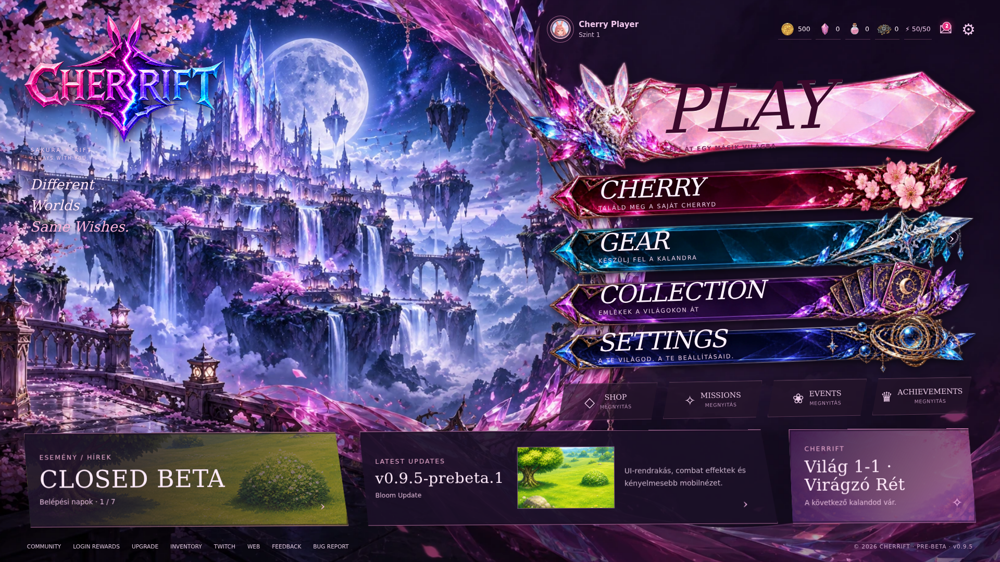

# CHERRIFT PC kristályfőmenü

A referencia alapján elkészült a jobb oldalra rendezett, működő PC főmenü. A különálló megjelenítési réteg a meglévő UI-navigációt hívja; nem ír mentést és nem módosít Supabase/auth kódot.

## Elrendezés és integráció

- A sorrend PLAY / CHERRY / GEAR / COLLECTION / SETTINGS. A Collection a meglévő ládanyitó/Gacha felületre vezet.
- Shop, Missions, Events és Achievements az aktuálisan működő projektfunkciókra vezetnek. Az esemény modul hiányában az Events gomb letiltott.
- A felső sáv tényleges profilképet, keretet, nevet, szintet, Coin/Bloom Gem/Sakura Essence/Scrap értékeket, energiát és levélszámlálót mutat. Az energiafeltöltő ablak és a levelezés eredeti funkcióit hívja.
- A közösség, belépési jutalmak, Upgrade, Inventory, Twitch, weboldal, feedback és hibajelentés elérhető marad. A további aloldalak a meglévő navigációval is elérhetők.
- Az eseménypanel a tényleges Closed Beta modulból és az aktuális mentésből olvas. A verziót a CHERRIFT_BUILD szolgáltatja; a frissítési kivonatot az eredeti patch-card. A részletező ablak ugyanezt a valós kivonatot jeleníti meg.
- A HTML feliratok külön maradnak a grafikától. A leírások a meglévő magyar/angol nyelvbeállítást követik.
- A hoverhang a meglévő hangerőszabályozott CHERRIFT_V060.playClickSound funkciót használja. A kattintási hang meglévő globális kezelője változatlan.
- CSS transzformációs hover, fénycsík, kattintási átmenet, 18 lassú szirom/fénypont és egyetlen, eseményvezérelt parallax frame működik. A reduced-motion beállítás kikapcsolja a mozgást.
- A kapcsolódó PC panelek közös fantasy hátteret, kristályos fejlécdíszt, kereteket és kiválasztási stílust kapnak. A meglévő panelek tartalmi felépítése és kezelői megmaradnak.

## Mobil elkülönítése

A guard az eredeti desktop-szabályt követi: legalább 821 px szélesség, kivéve a legfeljebb 600 px magas érintéses fekvő nézetet. A CSS kizárólag `.crystal-desktop` alatt működik. Telefonon a teljes új DOM hiányzik, az új képek nem kapnak renderelő elemet. Átméretezéskor a függő PC-kattintás törlődik, az új DOM és osztályok eltűnnek. Az eredeti mobil HTML, CSS, navigáció és játékmenet nincs módosítva.

## Ellenőrzések

| Ellenőrzés | Eredmény |
| --- | --- |
| Valódi Chromium, 1366×768 / 1920×1080 / 2560×1440 / 3440×1440 / 1128×584 | Sikeres; a főmenü vezérlői képernyőn belül |
| PLAY, Cherry, Gear, Collection, Settings, Shop, Missions, Events, Achievements | Sikeres navigáció |
| Profil, Social, Login Rewards, Upgrade, Inventory, Mail, Feedback, energiaablak | Sikeres megnyitás |
| Visszatérés, modal Escape, nyelvváltás, desktop → mobil → desktop | Sikeres |
| Hover és elnémított interakciós hang | Sikeres |
| Chromium JavaScript futásidejű hibák | 0 |
| Mobil 390×844 és érintéses 844×390 képernyőkép az eredeti `02c199e` verzióhoz képest | Mindkettő képpontra azonos |
| `npm run validate` és `git diff --check` | Sikeres |
| `npm run test:desktop-menu` | 5/5 sikeres |
| `npm run test:integrity` | 34/34 sikeres |
| `npm run test:online-api` | 1/1 sikeres |
| `npm run test:gunner` | 5/5 sikeres |
| `npm run smoke:supabase-lock` | Sikeres |
| `npm run smoke` | Mind a 9 eset sikeres, beleértve a mobil, visszatérő Discord/GM, auth/cloud timeout eseteket |
| `npm run audit` | 0 szintaxis-/szignatúrahiba; a korábbi placeholder-/referenciafigyelmeztetések továbbra is jelen vannak |

A böngészős navigáció helyi vendégmentéssel futott. Az élő Discord OAuth-bejelentkezés nem kapott külön végponttól végpontig tesztet. Az automatizált visszatérő session- és auth/cloud-tesztek sikeresek. Adatbázis- és Edge Function-telepítés nem történt.

## Rövid összevetés a referenciával

Megvalósult a jobb oldali, döntött kristálynavigáció, a kiemelt PLAY, a bal oldali mély fantasy táj, a középső íves rózsaszín kristálydísz, valamint a felső információs és alsó hírsáv. A háttér és a gombok önálló új grafikák; nem a teljes referenciaképre helyezett láthatatlan kattintási területek. A meglévő CHERRIFT logó változatlan. A tájkép és díszítőmotívumok új változatok, az alsó panelképek a projekt valódi pályaképei. A referencia fiktív eseményeit, pénznemeit és verziószámát nem használjuk.

## Módosított / hozzáadott fájlok

- `index.html` – az új modul/stílus betöltése és egységes cache buildazonosító.
- `src/cherrift_manifest.json` – az új prezentációs modul és stílus nyilvántartása.
- `src/cherrift_desktop_menu.js` – kizárólagos PC megjelenítés, eredeti navigációs hívások, valódi adatok, fókusz és parallax.
- `assets/cherrift_desktop_menu.css` – elkülönített PC főmenü és aloldalstílus.
- `assets/ui/backgrounds/crystal-realm-pc.webp` – új fantasy táj és íves kristálykompozíció.
- `assets/ui/buttons/crystal-play-pc.webp`
- `assets/ui/buttons/crystal-cherry-pc.webp`
- `assets/ui/buttons/crystal-gear-pc.webp`
- `assets/ui/buttons/crystal-collection-pc.webp`
- `assets/ui/buttons/crystal-settings-pc.webp` – öt szöveg nélküli, átlátszó gombgrafika.
- `tools/desktop_menu.test.mjs` – mobilhatár, navigáció/adatváltozatlanság, átméretezés, overlay-fókusz és zárolás/nyelv regresszió.
- `package.json`, `.github/workflows/ci.yml` – az új teszt bekötése.
- `docs/PC_MAINMENU_REWORK.md` – ez az összefoglaló.
- `docs/pc-mainmenu/desktop-1920x1080.png` – működő alkalmazás képernyőképe.

## Grafikai forrás

A képek a beépített imagegen eszközzel készültek. A háttér WebP optimalizálást kapott, a gombatlasz öt külön átlátszó WebP-re lett szétvágva. A hat új futásidejű grafika összesen körülbelül 1 MiB.

Háttérprompt: prémium anime-fantasy lobby-háttér; bal 58%-on kék/lila lebegő királyság, kristálykastély, hold, vízesések és sakura; jobb 42%-on sötét üres navigációs tér; középen nagy íves magenta kristály/szalag; alul sötétebb hírsáv; felirat, logó, UI és karakter nélkül.

Gombprompt: öt elkülönített, szöveg nélküli, átlátszó hátterű kristálykeret; dupla magas, halványrózsaszín PLAY kristálylap bal oldali nyúlfül-kristállyal; bordó sakura-, cián fegyver-, lila kártya- és indigó égitestdíszes további keretek; tiszta feliratterület, fénylő élek, a referenciával egyező anime-fantasy stílus.
