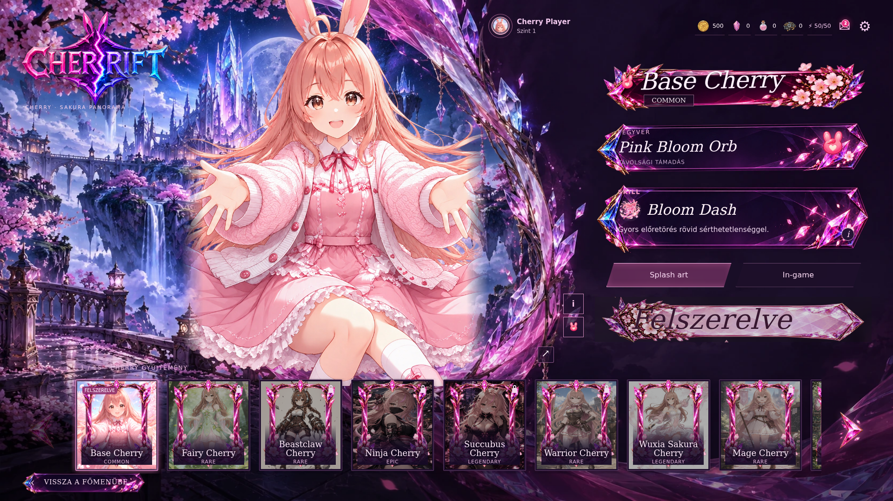
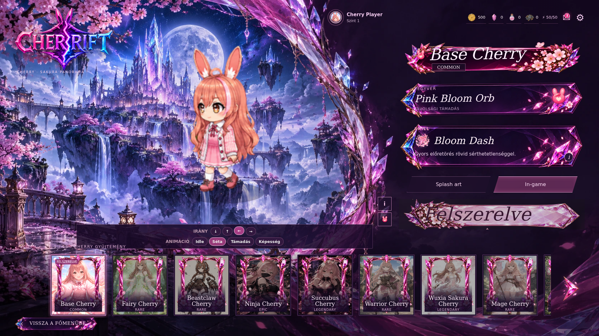

# PC Cherry skinválasztó – Sakura Panorama

Az elfogadott 02 / Sakura Panorama koncepció működő megvalósítása, az előző kristályfőmenü stílusában. Alap: `5f948665222e55a9308a01e7806a7bf6c9f1a471` (az előző főmenüt már tartalmazó GitHub main).

## Megvalósítás

A kiválasztott skin nagy bemutatóképet kap, alul vízszintesen lapozható portrékártyák, jobbra egyedi kristályos név-, fegyver- és képességpanelek vannak. A fejléc a főmenü tényleges profilját, erőforrásait, levelezését, energiáját és beállításfunkcióját tükrözi. A meglévő logó és fantasy táj megmarad.

A natív skinválasztó gombjait és kezelőit használjuk: a kiválasztás, zárolás, felszerelés, teljes splash art, passzív/képesség/elem információ, a játékbeli sprite-előnézet irány- és animációvezérlői az eredeti rendszeren futnak. Az új modul nem módosítja a karakteradatokat, az unlock-szabályokat, a mentést, az authentikációt vagy a játékmenetet. A megjelenített fegyver és képesség a játék valódi adataiból származik; a koncepcióban szereplő fiktív leírások nem kerültek a játékba.

Skinváltáskor az előző és az új bemutatókép finom áttűnést és oldalirányú mozgást kap; az információs oldal külön animál. A portrék hover-kiemelést, a skinsor gördülékeny lapozást kap. Használható az egérgörgő, a lapozónyíl és a billentyűzet (bal/jobb, Home/End). Visszatérés a főmenübe rövid kilépési animációval, a saját visszagombbal vagy Escape-pel lehetséges. A nyitott modális ablakokat az Escape navigáció figyelembe veszi.

A hover a meglévő hangerőszabályozott menühangot használja. A reduced-motion beállítás kikapcsolja az új mozgásokat. Az animációk transzformációt/átlátszóságot használnak; 12 könnyű CSS-szirom ad háttérmozgást.

## Grafikai assetek

Hét új WebP (~948 KiB összesen): szöveg nélküli címkeret, információs panel, világos action-gomb, átlátszó közepű portrékeret, két lapozónyíl és Base Cherry háttér nélküli bemutatóképe. A többi skin a meglévő eredeti splash artot használja finom peremátmenettel. A feliratokat HTML jeleníti meg.

A beépített imagegen készült grafikai kérései:

- UI-atlasz: a kiválasztott Sakura Panorama koncepció stílusában különálló sötét bordó sakurás címkeret; sötétlila kristályos információs panel; világos rózsaszín action-gomb; üres közepű álló portrékeret; két kristályos lapozónyíl. Minden elem átlátszó hátterű és szöveg nélküli. Az atlasz külön WebP-kre lett szétvágva.
- Base Cherry: az eredeti splash art háttér-eltávolítása; az eredeti karakter, arc, haj, ruha és póz megőrzése; valódi alfaátlátszóság. Ez külön PC-s prezentációs asset, nem a meglévő karaktergrafika felülírása.

## Mobil elkülönítése

Az új modul kizárólag az eredeti PC-guard mellett és a megnyitott skins képernyőn működik. A CSS a `.sakura-skins` útvonalosztályhoz kötött. Mobilon az új UI-elemek nem épülnek fel. PC → mobil átméretezéskor az új elemek és hozzáadott attribútumok eltűnnek, a natív elrendezés visszaáll; a függő kilépési animáció törlődik. A meglévő mobil HTML/CSS/JS nincs átírva.

## Tesztelés

| Ellenőrzés | Eredmény |
| --- | --- |
| Chromium – 1366×768, 1920×1080, 2560×1440, 3440×1440, 1128×584 | Sikeres; vezérlők a képernyőn belül |
| Mind a 15 skinnév, 1366×768 és 1920×1080 | Elfér a címkeretben |
| Zárolt skin preview, letiltott equip és rejtett In-game mód | Sikeres |
| Tényleges felszerelés az eredeti kezelővel | Sikeres, helyi tesztmentéssel |
| In-game preview, sétaanimáció, balra nézés | Sikeres |
| Teljes splash art, skill-dialog, passzív/elem információ | Sikeres |
| Lapozónyíl és billentyűs skinváltás | Sikeres |
| Vissza, Escape, PC → mobil → PC váltás | Sikeres |
| Böngészős JavaScript hibák | 0 |
| Mobil 390×844 és érintéses 844×390 képpont-összehasonlítás a jelenlegi mainnel | Mindkét skinválasztó képpontra azonos |
| Új `test:desktop-skins` | 5/5 sikeres |
| Meglévő desktop-menu / integrity / online-api / gunner tesztek | 5 + 34 + 1 + 5 sikeres |
| Összes automatizált unit/integrációs teszt | 50/50 sikeres |
| Indítási smoke-tesztek | 9/9 sikeres, mobil és visszatérő Discord/GM, auth/cloud timeout esetekkel |
| Supabase auth-lock smoke | Sikeres |
| Validate és diff whitespace check | Sikeres |

A böngészős teszt helyi vendégmentést használt. A második skin felszereléséhez csak ebben a helyi tesztmentésben lett tulajdonjog hozzáadva; szerveradat vagy élő fiók nem módosult. Élő Discord OAuth-folyamat nem volt újra végigtesztelve. A repository audit továbbra is jelez korábbi placeholder-/referenciaeltéréseket, szintaxis-/szignatúrahiba nélkül.

## Fájlok

- `src/cherrift_desktop_skins.js`
- `assets/cherrift_desktop_skins.css`
- `assets/ui/skins/base-cherry-panorama-pc.webp`
- `assets/ui/skins/panorama-title-pc.webp`
- `assets/ui/skins/panorama-info-pc.webp`
- `assets/ui/skins/panorama-action-pc.webp`
- `assets/ui/skins/panorama-card-pc.webp`
- `assets/ui/skins/panorama-prev-pc.webp`
- `assets/ui/skins/panorama-next-pc.webp`
- `index.html` – új fájlok betöltése, egységes cache buildazonosító.
- `src/cherrift_manifest.json` – az új PC-s modul/stílus nyilvántartása.
- `tools/desktop_skins.test.mjs`
- `package.json`, `.github/workflows/ci.yml` – az új teszt bekötése.
- `docs/PC_SKIN_SELECTOR_REWORK.md`
- `docs/pc-skins/sakura-panorama-1920x1080.png`
- `docs/pc-skins/ingame-preview-1920x1080.png`

A GitHubra feltöltést és PR-létrehozást a kapcsolat `403 Resource not accessible by integration` jogosultsági hibája blokkolta. A kész változtatás külön helyi ágon és a letölthető átadócsomagban elérhető. Élesítés és merge nem történt.
